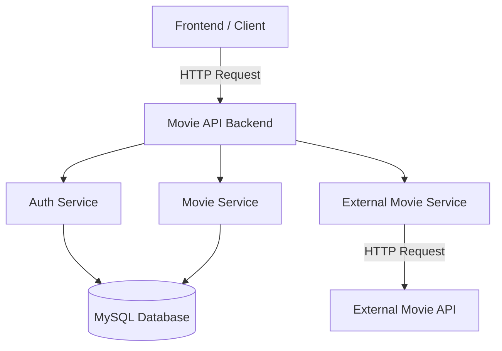

# Microservices Design - Movie API

## 1. แนวคิดการออกแบบระบบ

โปรเจกต์ Movie API เป็นระบบจัดการข้อมูลภาพยนตร์ที่มีการแบ่งความรับผิดชอบของระบบออกเป็นส่วนย่อยตามหน้าที่ เพื่อให้สามารถพัฒนา ทดสอบ และดูแลแต่ละส่วนได้ง่าย

ในการพัฒนาโปรเจกต์นี้เลือกใช้แนวทาง **Modular Monolith** คือยังคงทำงานอยู่ภายใน Backend application เดียว แต่แบ่งโครงสร้างและความรับผิดชอบออกเป็น Logical Services ที่สามารถแยกเป็น Microservices จริงได้ในอนาคต

แนวทางนี้เหมาะกับโปรเจกต์ขนาดเล็กและทีมพัฒนาที่มีจำนวนสมาชิกไม่มาก เนื่องจากช่วยลดความซับซ้อนในการ deploy และดูแลระบบ แต่ยังสามารถแสดงแนวคิดของ Microservices ได้อย่างชัดเจน

---

## 2. Service Decomposition

ระบบแบ่ง Logical Services ออกเป็น 3 ส่วนหลัก ดังนี้

| Service                | หน้าที่หลัก                                                                              | Main Endpoints                                                                                                                                                                                                                                   |
| ---------------------- | ---------------------------------------------------------------------------------------- | ------------------------------------------------------------------------------------------------------------------------------------------------------------------------------------------------------------------------------------------------ |
| Movie Service          | จัดการข้อมูลภาพยนตร์ การค้นหา การเรียงลำดับ Pagination และ Genre                         | `GET /api/v1/movies`, `POST /api/v1/movies`, `GET /api/v1/movies/{id}`, `PUT /api/v1/movies/{id}`, `DELETE /api/v1/movies/{id}`, `GET /api/v1/genres`, `POST /api/v1/genres`, `GET /api/v1/movies/{id}/genres`, `PUT /api/v1/movies/{id}/genres` |
| Auth Service           | จัดการผู้ใช้งาน การสมัครสมาชิก การเข้าสู่ระบบ JWT และตรวจสอบสิทธิ์                       | `POST /api/v1/auth/register`, `POST /api/v1/auth/login`, `GET /api/v1/auth/me`                                                                                                                                                                   |
| External Movie Service | ติดต่อ External Movie API เพื่อค้นหาข้อมูลภาพยนตร์ และจัดการ Retry, Timeout และ Fallback | `GET /api/v1/external/movies`                                                                                                                                                                                                                    |

### 2.1 Movie Service

Movie Service รับผิดชอบข้อมูลหลักของระบบ ได้แก่

- เพิ่มข้อมูลภาพยนตร์
- แสดงรายการภาพยนตร์
- แสดงรายละเอียดภาพยนตร์
- แก้ไขข้อมูลภาพยนตร์
- ลบข้อมูลภาพยนตร์
- ค้นหาภาพยนตร์
- เรียงลำดับข้อมูล
- Pagination
- จัดการ Genre
- เชื่อมโยงภาพยนตร์กับ Genre

ข้อมูลหลักที่เกี่ยวข้อง ได้แก่ `movies`, `genres` และ `movie_genres`

---

### 2.2 Auth Service

Auth Service รับผิดชอบเกี่ยวกับ Authentication และ Authorization ได้แก่

- สมัครสมาชิก
- เข้าสู่ระบบ
- สร้าง JWT Token
- ตรวจสอบ JWT Token
- ตรวจสอบข้อมูลผู้ใช้งาน
- ตรวจสอบ Role ของผู้ใช้งาน
- แยกสิทธิ์ระหว่าง `user` และ `admin`

ข้อมูลผู้ใช้งานถูกจัดเก็บในตาราง `users`

ระบบใช้ `bcrypt` สำหรับจัดการ Password Hash และใช้ `jsonwebtoken` สำหรับสร้างและตรวจสอบ JWT

---

### 2.3 External Movie Service

External Movie Service ทำหน้าที่ติดต่อกับ External Movie API เพื่อค้นหาข้อมูลภาพยนตร์เพิ่มเติม

การเรียก External API มีการออกแบบให้รองรับกรณีที่บริการภายนอกไม่สามารถใช้งานได้ โดยมี

- Timeout 5 วินาที
- Retry สูงสุด 2 ครั้งหลังจากการเรียกครั้งแรก
- Delay 500 milliseconds ก่อน Retry ครั้งที่ 1
- Delay 1,000 milliseconds ก่อน Retry ครั้งที่ 2
- Fallback Response เมื่อไม่สามารถเรียก External API ได้

การแยกส่วนนี้ออกจาก Movie Service ช่วยให้ Logic ที่เกี่ยวข้องกับ External API ไม่ปะปนกับ Logic การจัดการข้อมูลภาพยนตร์ภายในระบบ

---

## 3. System Architecture

